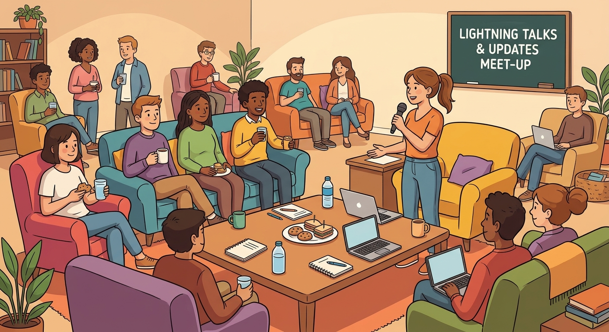

# Laravel Toronto meet-up, Oct 29/2026
Laravel Toronto meet-up, on Oct 29, 2026 (Updates & Talks)

 

- food & beverages sponsored by [Vetster.com](https://vetster.com) [Google Map](https://maps.app.goo.gl/eEqA4F8LPNsi5nqZA)
- Thank you to Tolga Ercan, and to everyone at Vetster, for making this meet-up happen!
- An extra THANK YOU for hosting this meet-up on extremely short notice!

##

Our regularly scheduled meet-up at Maple was cancelled, due to Maple's move to their new offices. When we originally scheduled this meet-up, there was a safe time cushion between the move and this meet-up. But, Life Happens, and that cushioned evaporated. We are very fortunate that Vetster gave us the thumbs up.

Maple was also scheduled to deliver the presentation. 

I do have updates for you at this meet-up. 

Two things came up at last month's meet-up: the idea of a "Laravel Live Toronto" conference; and, the duty of a non-profit director. I have hard updates on both.

The PHP Foundation's new "Special Interest Group - Community_ kick-off call is Wed 28th. I will be on that call. I will let you know how it went. Personally, this is not my first rodeo with this sort of thing, and generally it ends up being a complaint-fest. 

We'll see if anyone wants to take the podium to do a lightening talk about what they are up to. 

Doing these lightening talks have run hot and cold. So, I will do one about my custom podcasting application. Actually show the code, and the UI. Built with Claude AI -- not Code. If you enjoy making fun of other peoples' code, then this talk could be for you. With my previous custom app, my back-end served data to my Laravel front-ends. This time, my app sends data to Cloudflare Pages, using Astro. These static sites are a huge, glorious, success!

Schedule:
- 6:00pm to 7:00pm: meet-and-greet
- 7:00pm to 9:00pm: AI+PHP+Laravel

I am looking forward to seeing you! It has been a while!

-Bob Bloom

##
Meetup.com listing: [https://www.meetup.com/laravel-toronto/events/317122239/](https://www.meetup.com/laravel-toronto/events/317122239/)

## Links
- [https://thephp.foundation/blog/2026/09/28/kicking-off-the-community-events-coalition-sig/](https://thephp.foundation/blog/2026/09/28/kicking-off-the-community-events-coalition-sig/)
- [(YouTube) Top notch journalism courtesy of your tax dollars - maybe we should have a meet-up at CBC](https://www.youtube.com/watch?v=WiEXPHYA6xM)
